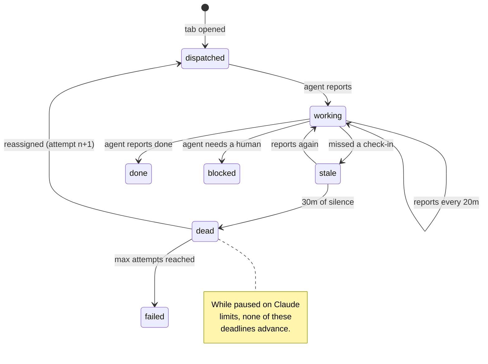

# Add joop: supervise Pi agents working labelled GitHub issues

Labelling a GitHub issue `loop` now gets it an agent in its own Zellij tab, supervised by a heartbeat that replaces agents which go quiet and stands down when Claude usage runs out.

[https://github.com/jaywhy13/joop/pull/1](https://github.com/jaywhy13/joop/pull/1) · by @jaywhy13

## What joop sits on top of

joop is new, so there is no prior joop to compare against. What it sits on top of are four
existing tools, and the change only makes sense once those are clear.

- **`gh`** is GitHub's command-line client. `gh issue list --label loop --json ...` returns
  matching issues as JSON, using whatever credentials `gh auth` already holds. joop never
  speaks to the GitHub API directly.
- **Zellij** is a terminal multiplexer: one long-lived *session* holds many named *tabs*, each
  running its own program. Its CLI drives a session from outside it, which is the part worth
  knowing: `zellij --session joop action new-tab --name issue-42 --cwd <dir> -- <command>`
  opens a tab and prints the new tab's numeric id on stdout. `close-tab-by-id`,
  `query-tab-names`, `go-to-tab-name` and `write-chars` round it out. That last one *types*
  into whichever pane is focused — there is no "send text to tab X" call, which later forces a
  design decision.
- **Pi** is a terminal coding agent. Started as `pi "<message>"`, it opens interactively with
  that message already submitted, so a prompt can be handed to it as a single argument.
- **`git worktree`** gives one repository several working directories, each on its own branch.

### The problem

Labelling an issue and then opening a tab, cutting a branch and pasting a prompt is manual
work that has to be repeated per issue. Worse, agents fail *quietly*: a Pi session can wedge,
crash, or sit at a prompt, and nothing notices. An unattended fleet needs a supervisor, not
just a launcher.

### Constraints that shaped it

- An agent cannot be trusted to announce its own death, so liveness must be inferred.
- Claude subscription capacity is finite and shared across every agent, so more agents is not
  always better.
- There is no first-party command for reading Claude usage limits. There *is* the undocumented
  endpoint Claude Code's own `/usage` reads.

### Out of scope

joop does not review, merge, or close anything. It does not remove the `loop` label. It opens
a tab and watches; the agent inside does the work.

### Essential files

- `src/engine.rs` — the whole cycle: poll, dispatch, audit, pause, resume.
- `src/state.rs` — `state.json`, and the heartbeat rules that read it.
- `src/zellij.rs` — every Zellij command joop issues.
- `src/limits.rs` — reading Claude usage.
- `src/api.rs` / `src/client.rs` — the localhost endpoint agents report to, and `joop report`.
- `src/runner.rs` — the seam that makes `gh`, `git` and `zellij` testable.
- `src/supervisor.rs` — the background thread and its cadence.

### Essential symbols

- `HeartbeatPolicy` — the three deadlines: first report, later reports, and death.
- `Session` — what joop knows about one issue: tab, branch, worktree, status, last report.
- `Engine::poll` — find labelled issues and give each one an agent.
- `Engine::audit` — decide which agents have gone quiet, and replace them.
- `Engine::check_limits` — stand down near a usage limit, and resume afterwards.
- `CommandRunner` — one trait over process spawning, so tests assert on command lines.


## A ward round, not a launcher

The useful mental model is a nurse doing rounds, not a job queue.

A job queue cares whether a task was *accepted*. A ward round cares whether the patient is
still *responding*. joop cannot open an agent's chest and look, so it asks for a sign of life
on a schedule and treats silence as the symptom:

- **2 minutes** to say anything at all after being woken.
- **20 minutes** between later check-ins.
- **30 minutes** of total silence and the patient is pronounced; the bed is cleared and the
  work goes to someone else.

Two consequences follow from that model, and they are the parts worth predicting before
reading any code.

**First: a replacement inherits the bed, not a blank one.** The dead agent's worktree and
branch are left exactly as they were, so attempt 2 starts in a directory that may already hold
attempt 1's half-finished work — and is told so.

**Second: the clock must stop when the ward loses power.** When Claude usage runs out, every
agent stops too. If the nurse kept counting, all of them would miss their 30-minute window at
once and joop would close every tab on the ward — including the ones it is about to send a
"carry on" message to. So a pause freezes the clock, and resumption restarts it.




## The cycle, in the order the pieces depend on each other

### Where the deadlines live

`HeartbeatPolicy` holds the three durations and nothing else, and `Session` answers two
questions about itself: when its current window started, and when it last reported. Keeping
those on the data rather than in the engine is what makes the pause rule expressible at all —
`baseline_at` returns the dispatch time, *or* the resumption that came after it, so one field
(`resumed_at`) shifts every deadline at once.

### Dispatch: three steps, and what happens when the third fails

Dispatch prepares a worktree, opens a tab, then records the session. The ordering matters,
because the recording can fail — a full disk, an unwritable state directory. The first version
of this change logged the error and moved on, which left a live Pi agent in a worktree joop had
no record of: the next poll would see the issue as unclaimed and start a *second* agent in the
same directory. Now a failed record closes the tab it just opened. `state.rs` reinforces it
from the other side: a write that fails rolls the change back in memory, so joop never believes
in a claim that `state.json` does not contain.

### Why an issue is dispatched exactly once

The first version treated "claimed" as "not finished", so re-dispatching an issue whose agent
reported `done` looked harmless. It is not: an open issue keeps its `loop` label after the work
is done, so joop would open a fresh tab for it on every poll, forever. `is_claimed` is now
simply "joop has a record of this issue", and `joop forget --issue N` (or `f` on the dashboard)
is the deliberate way to hand one out again. The trade-off is a manual step; the alternative was
an infinite tab fountain.

### Audit: inferring death, and the pause that must not count

`audit` compares each live session against the policy. Past the first deadline it goes `stale`
and joop just notes it; past the death deadline it goes `dead`, its tab is closed, and the
issue goes to a replacement in the same worktree.

Two refinements matter. A session whose Zellij tab has *vanished* is declared dead immediately
rather than waiting out its heartbeat — a tab the user closed by hand is an agent that is not
coming back. And reassignment refuses to start if the old tab could not be closed, because two
agents in one worktree would quietly corrupt each other's work; the issue stays queued and the
next audit tries again. Reassignment is capped at `--max-attempts` (3), after which the issue
is parked as `failed`.

The pause rule is the single most consequential line in the change: `audit` returns early while
joop is paused. A usage window can be hours; the death deadline is 30 minutes. Without that
early return a pause killed every agent joop had, and the resumption message had nothing left
to talk to.

### Limits: standing down, and waking back up

`check_limits` reads the tightest Claude limit and compares it to a threshold. Over it, joop
stops dispatching and records when the limit resets. Under it — and past the reset — joop
resumes, and here the Zellij constraint from the background bites: `write-chars` types into the
*focused* pane, so telling five agents to carry on means focusing five tabs in turn. joop
remembers which tab the user was on and puts the focus back, otherwise resuming would yank the
user's terminal around.

The reading itself is undocumented, which drives the failure posture: an unreadable endpoint is
reported as *unknown*, and `LimitSnapshot::unknown()` is never exhausted. A shape change there
degrades to "keep working", never to a silent stall. `--no-limit-checks` opts out.

### How any of this is testable

Every external tool sits behind a trait over `CommandRunner`, and time behind `Clock`. The
tests assert on the exact `gh`, `git` and `zellij` command lines joop *would* run without
running them, and drive a `FixedClock` forward to reach a 30-minute death deadline instantly.
146 tests, evidence in `src/engine.rs`, `src/state.rs` and `src/supervisor.rs`.

### What is deliberately unchanged

joop never edits the issue, the label, or the branch's contents. It does not merge. The
`loop` label remains the only gate — and therefore the trust boundary, since issue text flows
straight into an agent's prompt.


## The three deadlines

**Location:** `src/state.rs` · `HeartbeatPolicy`

```diff
+/// How often joop expects to hear from a Pi session.
+#[derive(Debug, Clone, Copy)]
+pub struct HeartbeatPolicy {
+    /// Grace period between opening the tab and Pi's first report.
+    pub first_update: Duration,
+    /// Maximum gap between subsequent reports.
+    pub subsequent_updates: Duration,
+    /// Silence after which joop declares the agent dead, cleans up its tab and
+    /// hands the issue to another agent.
+    pub dead_after: Duration,
+}
```

## One field shifts every deadline

**Location:** `src/state.rs` · `Session::baseline_at`, `Session::last_heartbeat`

This is what makes the pause rule expressible: a resumption moves the window, and reports from
before the pause stop counting.

```diff
+    /// When the current heartbeat window started: the dispatch, or the resumption that
+    /// came after it.
+    pub fn baseline_at(&self) -> DateTime<Utc> {
+        match self.resumed_at {
+            Some(resumed) if resumed > self.dispatched_at => resumed,
+            _ => self.dispatched_at,
+        }
+    }
+
+    /// The agent's last report, ignoring any that predates the current window.
+    pub fn last_heartbeat(&self) -> Option<DateTime<Utc>> {
+        self.last_update_at
+            .filter(|reported| *reported >= self.baseline_at())
+    }
```

## The pause rule

**Location:** `src/engine.rs` · `Engine::audit`

```diff
+    /// Check every live session against the heartbeat policy, cleaning up and replacing
+    /// agents that have gone quiet.
+    ///
+    /// While joop is paused on Claude limits the heartbeat clock does not run: the agents
+    /// are out of capacity too, so declaring them dead would close every tab there is and
+    /// leave nothing to resume.
+    pub fn audit(&self) -> Result<()> {
+        if self.is_paused() {
+            return Ok(());
+        }
```

## Dispatched once, not once per poll

**Location:** `src/state.rs` · `State::is_claimed`

```rust
    /// True when joop has already taken this issue on. joop handles an issue once:
    /// an open issue keeps its label after the work is finished, so re-dispatching on
    /// status alone would open a fresh tab on every poll, forever. `forget` is the way
    /// to hand the same issue out again.
    pub fn is_claimed(&self, repo: &str, issue_number: u64) -> bool {
        self.session(repo, issue_number).is_some()
    }
```

## Resuming, and giving the focus back

**Location:** `src/engine.rs` · `Engine::nudge_running_agents`

`write-chars` types into the focused pane, so there is no way to message a tab without visiting
it. The last three lines are the apology for that.

```rust
    fn nudge_running_agents(&self, now: DateTime<Utc>) -> Result<()> {
        let resumed = lock(&self.state).resume_live_sessions(now)?;
        if resumed.is_empty() {
            return Ok(());
        }

        // Typing into a tab means focusing it, so remember where the user was.
        let was_focused = self.tabs.current_tab_name().ok().flatten();
```

## The Zellij command, asserted exactly

**Location:** `src/zellij.rs` · `opens_a_named_tab_in_the_worktree_running_the_given_command`

The `CommandRunner` seam means the test reads the command line joop would have run, without a
Zellij session existing.

```rust
    fn opens_a_named_tab_in_the_worktree_running_the_given_command() {
        let runner = RecordingRunner::returning([CommandOutput::succeeded("7\n")]);

        let tab_id = ZellijTabs::new(&runner, "joop").open(&spec()).unwrap();

        assert_eq!(tab_id.as_deref(), Some("7"));
        assert_eq!(
            runner.last_call().display(),
            "zellij --session joop action new-tab --name issue-42 \
             --cwd /worktrees/issue-42 -- pi /implement issue 42"
        );
    }
```

## An unreadable limit means "unknown", never "exhausted"

**Location:** `src/limits.rs` · `LimitSnapshot::unknown`, `LimitSnapshot::is_exhausted`

```diff
+    /// Unconstrained, used when joop cannot read the usage endpoint. joop keeps working
+    /// rather than stalling on a reading it could not take.
+    pub fn unknown() -> Self {
+        Self {
+            utilization: 0.0,
+            limit: "unknown".into(),
+            resets_at: None,
+        }
+    }
```

## Check your understanding

1. A Claude usage window resets in four hours and joop pauses. Why would running the heartbeat
   audit during those four hours defeat the resumption message entirely?
2. `is_claimed` returns true even for a session whose agent reported `done`. What goes wrong if
   it returns false instead, given that joop never touches the `loop` label?
3. Dispatch opens the Zellij tab before writing to `state.json`. Why must a failed write close
   that tab rather than just log the error?
4. Reassignment refuses to start a replacement when the dead agent's tab could not be closed,
   and leaves the issue queued. What failure is that refusal preventing?
5. `LimitSnapshot::unknown()` reports 0% utilization rather than 100%. Why is that the safer
   default for a reading joop could not take?

## Answers

1. A pause lasts far longer than the 30-minute death deadline, so every agent would miss its
   window at once. joop would mark them all dead and close their tabs — and the resumption
   message is sent to *running* tabs, so there would be none left to tell. The pause would
   destroy exactly the agents it exists to preserve.
2. An open issue keeps its `loop` label after the work is finished, so it still appears in
   every `gh issue list`. With `is_claimed` false, joop would cut a worktree and open a new tab
   for it on every poll — a new agent every ten minutes, forever. `joop forget` makes re-running
   an issue a deliberate act instead.
3. A recorded session is what makes an agent supervisable. Without the record joop has a live
   Pi agent in a worktree it knows nothing about: it cannot heartbeat it, cannot close it, and
   the next poll sees the issue as unclaimed and starts a *second* agent in the same directory.
   Closing the tab keeps joop's knowledge and reality in step.
4. Two agents editing one worktree. The replacement reuses the dead agent's worktree and branch
   deliberately, so partial work survives — but that only holds if the previous agent is really
   gone. If the close failed, the old agent may still be writing, so joop would rather wait and
   retry on the next audit than have two agents overwrite each other.
5. The endpoint is internal and undocumented, so it can change shape without warning. Treating
   a failed reading as exhausted would make every such change look like "no capacity", and joop
   would stop dispatching and stop auditing indefinitely with nothing visibly broken. Reporting
   unknown degrades to "keep working", which is a failure the user will actually notice and can
   override with `--no-limit-checks`.

